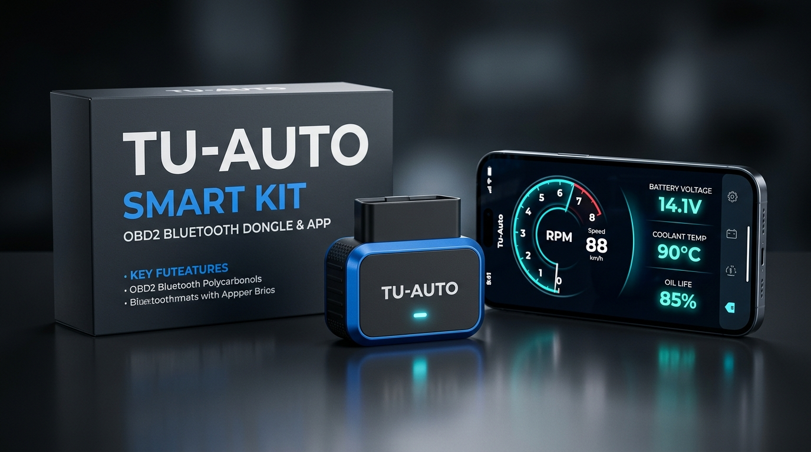

# 🚗 Tu-Auto: Copiloto Inteligente, Kit OBD2 y Predictor Financiero Vehicular

**Tu-Auto** es un ecosistema de Hardware + Software (iOS / Android / Web) que se conecta a la computadora del auto mediante un **Kit Económico OBD2 Bluetooth** y traduce en tiempo real el estado del sistema eléctrico, la temperatura del agua, el desgaste del aceite y las fallas ocultas a **lenguaje humano y dinero**.

---

## 📊 Control de Desarrollo en Vivo (Tablero Ágil)

👉 **[Abrir Tablero Kanban y Sprints en Vivo (`BACKLOG.md`)](./BACKLOG.md)**
*(Gestionado automáticamente por Agentes de IA mediante identificadores `TUA-001` a `TUA-028` y compatible con **Linear.app** / **GitHub Projects V2**).*

---

## 📚 Índice Maestro de Documentación y Auditoría del Proyecto

### 🏢 1. Producto, Mercado y Finanzas
1. 🌍 **[01 - Estudio de Mercado y Referentes Mundiales](./docs/01-estudio-mercado-referentes.md)**
   * Análisis de **FIXD**, **Carly**, **Bouncie**, **Zubie**, **Engie** y **Jooycar** (Latinoamérica). Precios, modelos y oportunidad local.
2. 💰 **[03 - Modelo de Negocio, Monetización y Plan de MVP](./docs/03-modelo-negocio-y-mvp.md)**
   * Las 3 fuentes de ingreso (Kit B2C + Suscripción, Marketplace de Lubricentros/Talleres, y Flotas B2B Uber/Remises) y pantallas del MVP.
3. 📈 **[07 - Auditoría Financiera, Unit Economics y Plan Comercial](./docs/07-finanzas-y-plan-comercial.md)**
   * Costos exactos por unidad del Kit (\$4.60 a \$9.30 USD), margen de ganancia (66% a 83%), costos de plataformas (\$0 inicial) y proyección de caja a 12 meses.

### 🔌 2. Hardware Propio ("El Kit Económico")
4. 🛠️ **[04 - Nuestro Propio Kit Económico: Hardware, Planos y Fabricación](./docs/04-kit-hardware-y-planos.md)**
   * **Etapa 1 (OEM Rápido):** Especificación exacta de compra (`PIC18F25K80` BLE 4.0 Dual-Mode) + Packaging con QR.
   * **Etapa 2 (Hardware Propio "Tu-Auto V1"):** Planos de ingeniería completos con microcontrolador **ESP32-C3**, transceptor CAN `SN65HVD230`, pinout OBD2 de 16 pines, divisor resistivo para medir batería al milisegundo, alarma sonora (buzzer) integrada y lista de materiales (BOM) de **\$5.20 USD**.

### 💻 3. Ingeniería de Software, Features, Base de Datos y Gestión Ágil
5. ⚙️ **[02 - Información del Sistema y Lógica de Sensores](./docs/02-arquitectura-y-sistema.md)**
   * Cómo medimos batería en arranque, temperatura real de agua (anti-aguja mentirosa), desgaste de aceite por horas de tráfico y Modo 07 predictivo.
6. 🛡️ **[05 - Auditoría Técnica de Desarrollo, Stack, Plataformas y Features](./docs/05-auditoria-tecnica-y-arquitectura.md)**
   * Stack completo (**React Native + Expo + TypeScript + SQLite Offline-First + Supabase + MercadoPago**), secuencia de datos y catálogo de los **7 Módulos del Sistema**.
7. 🗄️ **[06 - Arquitectura de Base de Datos y Esquema SQL Completo](./docs/06-base-de-datos-y-esquema.md)**
   * Diagrama Entidad-Relación (ERD) y script SQL completo listo para ejecutar en PostgreSQL / Supabase.
8. 🛠️ **[08 - Especificación Funcional de Features y Manual de Desarrollo](./docs/08-especificacion-features-y-desarrollo.md)**
   * Contratos TypeScript (`IOBD2DataSource`, `LiveTelemetryFrame`), Épicas F1 a F7, fórmulas exactas, criterios de aceptación y diseño de las 4 pestañas.
9. 📋 **[09 - Plataforma de Gestión de Proyecto (Superadora a Taiga) y Sprints](./docs/09-gestion-proyecto-y-roadmap-sprints.md)**
   * Comparativa **Linear vs. GitHub Projects V2 vs. Plane** (reemplazando a Taiga) y hoja de ruta detallada de los **4 Sprints de Desarrollo**.

### 🤖 4. Documentación y Skills para Agentes de IA
10. 🧠 **[AGENTS.md — Guía Maestra para Agentes de IA](./AGENTS.md)**
    * Reglas de arquitectura, estructura de directorios y estándares obligatorios para cualquier agente de IA que programe en este repositorio.
11. 📋 **[Skill: `agile-backlog-manager`](./.agents/skills/agile-backlog-manager/SKILL.md)**
    * Flujo obligatorio para actualizar el estado de las tareas `TUA-XXX` en [`BACKLOG.md`](./BACKLOG.md), Linear y GitHub Projects.
12. ⚡ **[Skill: `obd2-elm327-protocol`](./.agents/skills/obd2-elm327-protocol/SKILL.md)**
    * Comandos `AT`, PIDs hexadecimales, fórmulas matemáticas de conversión y decodificación binaria de fallas Modo 03 / Modo 07.
13. 🔧 **[Skill: `mecanica-y-costos-latam`](./.agents/skills/mecanica-y-costos-latam/SKILL.md)**
    * Reglas de traducción a español rioplatense/latino, semáforo de gravedad y estructura del "Escudo Anti-Estafas" con costos reales.
