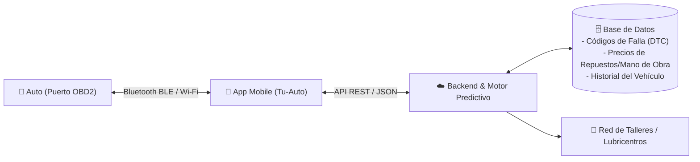

# ⚙️ 02. Información del Sistema y Arquitectura Técnica

Para construir **Tu-Auto** sin sorpresas técnicas, este documento define exactamente **qué información entra al sistema**, **cómo la obtenemos del vehículo** y **cómo la procesamos** para cumplir la promesa al usuario.

---

## 1. Arquitectura General del Sistema

### Componentes:
1. **Conector de Hardware (En el auto):** Escáner **OBD2 (On-Board Diagnostics II)** basado en el chip estándar **ELM327** (preferentemente versión 1.5 o Bluetooth 4.0 BLE para que funcione tanto en Android como en iPhone). Se enchufa debajo del volante sin herramientas.
2. **Aplicación Móvil (En el bolsillo del conductor):** Desarrollada en **React Native (Expo)** para tener una sola base de código que funcione en Android y iOS. Se conecta automáticamente por Bluetooth apenas el usuario sube al auto y pone contacto.
3. **Motor de Inteligencia y Costos (En la nube):** Recibe las lecturas del auto, las cruza con el modelo/año del vehículo y devuelve diagnósticos en español claro, nivel de gravedad y costo estimado de reparación.

---

## 2. ¿Qué detecta el sistema y cómo lo hace? (Realidad Técnica)

Es fundamental separar lo que la computadora del auto (**ECU**) entrega en directo por el puerto OBD2 y lo que **nuestro algoritmo inteligente** calcula combinando datos:

### A. Sistema Eléctrico y Batería ⚡
* **Dato directo del OBD2:** Comando `AT RV` y PID `01 42` (Voltaje del módulo de control).
* **Cómo funciona nuestro detector:**
  1. **En reposo (Contacto sin arrancar):** Si mide menos de `12.1V`, la batería está envejecida o descargada.
  2. **En el momento del arranque (Cranking):** El sistema mide la caída de tensión durante el giro del burro de arranque. Si cae por debajo de `9.6V`, la app dispara una alerta: *"Batería al límite: riesgo alto de que no arranque en los próximos días fríos"*.
  3. **Con el motor en marcha (Alternador):** Debe medir entre `13.8V` y `14.4V`. Si mide menos de `13.2V` o más de `14.8V`, la app alerta: *"Falla en el Alternador / Regulador de voltaje: estás andando solo con la batería, te vas a quedar tirado en menos de 40 minutos"*.

### B. Sistema de Refrigeración ("El Agua") y Temperatura 🌡️
* **Dato directo del OBD2:** PID `01 05` (Temperatura del líquido refrigerante en °C exactos).
* **Limitación de los autos comunes:** La mayoría de los autos económicos/medianos **no tienen sensor de nivel de líquido** en el bidón de agua, y la aguja del tablero suele estar "clavada" en 90°C aunque el motor ya esté en 103°C (los fabricantes lo hacen para no asustar al conductor, y cuando prende la luz roja ya soplaste la junta de tapa de cilindros).
* **Cómo lo resuelve Tu-Auto:**
  1. **Lectura digital real grado por grado:** Si el auto trabaja normalmente a 90°C-95°C y el sensor detecta una subida inusual a **102°C** o una velocidad de calentamiento anormalmente rápida en los primeros 3 minutos (síntoma clásico de que **se quedó sin agua** por una manguera rota o falla el termostato), el celular emite una **alarma sonora de emergencia** antes de que el tablero del auto avise.
  2. **Recordatorio preventivo:** Avisa cuándo purgar y cambiar el líquido refrigerante (cada X km o 1-2 años) para evitar picaduras en el radiador y bomba de agua.

### C. Aceite y Mantenimiento Preventivo 🛢️
* **Dato directo del OBD2:** Kilometraje recorrido (o distancia desde el último borrado de códigos, PID `01 31`), Tiempo de motor encendido (PID `01 1F`), RPM (`01 0C`) y Temperatura de trabajo.
* **Cómo funciona el Predictor de Cambio de Aceite:**
  * Un auto que hace 10.000 km en ruta desgasta el aceite mucho menos que un auto de Uber o de ciudad que hace 10.000 km en embotellamientos (donde el motor está horas regulando sin sumar kilómetros).
  * **Tu-Auto** calcula el **"Desgaste Real del Aceite"**: suma tanto los kilómetros como las **horas de motor en marcha** y los arranques en frío. Así le avisa al usuario: *"Aunque hiciste 7.500 km, por el uso pesado en tráfico tu aceite está al 12% de vida útil. Programá el cambio esta semana"*.

### D. Diagnóstico de Roturas y "Qué tan grave es" 🔧
* **Dato directo del OBD2:** Modos `03` (Códigos de falla confirmados - DTC), `07` (Fallas pendientes que **todavía no prendieron la luz en el tablero**) y `01 01` (Estado del Check Engine).
* **El "Modo 07" es nuestro superpoder:** Nos permite avisarle al usuario que una bujía, un inyector o un sensor de oxígeno empezó a fallar de forma intermitente **días o semanas antes** de que se prenda el Check Engine en el tablero.

---

## 3. El Semáforo de Gravedad y "Predictor de Billetera" 🚦💸

Cada vez que el sistema detecta una anomalía, no muestra códigos raros, sino una tarjeta con 4 datos clave:

1. **Nivel de Gravedad (Semáforo):**
   * 🟢 **Verde (Todo en orden / Mantenimiento programado):** *"En 800 km te toca cambio de aceite y filtro"*.
   * 🟡 **Amarillo (Atención - No urgente pero no dejar pasar):** *"Bujía o bobina con fallo leve en cilindro 2. Podés seguir usando el auto, pero va a consumir un 15% más de nafta. Revisalo este mes"*.
   * 🔴 **Rojo (Peligro Inminente - Frená o no uses el auto):** *"Sobrecarga de temperatura (106°C) o falla crítica de presión/alternador. Detené el auto en un lugar seguro ahora mismo para evitar fundir el motor"*.
2. **Qué se rompió (En español sencillo):** Explicación de 2 renglones de qué hace esa pieza.
3. **Costo estimado del arreglo hoy:** Rango de precio actualizado (Repuesto + Mano de obra estándar).
4. **Costo de "Hacerse el distraído" (Riesgo financiero):** Cuánto te va a salir si seguís andando así y se rompe la pieza siguiente en la cadena.

---

## 4. Módulo de "Tracking Financiero del Auto" 📊

Para que el usuario sienta que la app le cuida el bolsillo todos los días (incluso cuando el auto no tiene fallas), el sistema incluye:
* **Índice de Salud del Auto (0% a 100%):** Un puntaje grande en la pantalla principal que sube cuando hacés los mantenimientos a tiempo y baja si tenés alertas pendientes.
* **Proyección de Gastos a 6 meses:** Una línea de tiempo que le dice: *"En noviembre tenés cambio de aceite (\$65.000). En febrero te toca distribución (\$280.000). Te recomendamos separar \$45.000 por mes para que no te sorprenda"*.
* **Historial Clínico Verificado:** Todo arreglo o cambio de aceite queda registrado con fecha y kilometraje escaneado por la computadora (ideal para demostrarle al próximo comprador que el auto estuvo impecablemente mantenido y venderlo más caro).
