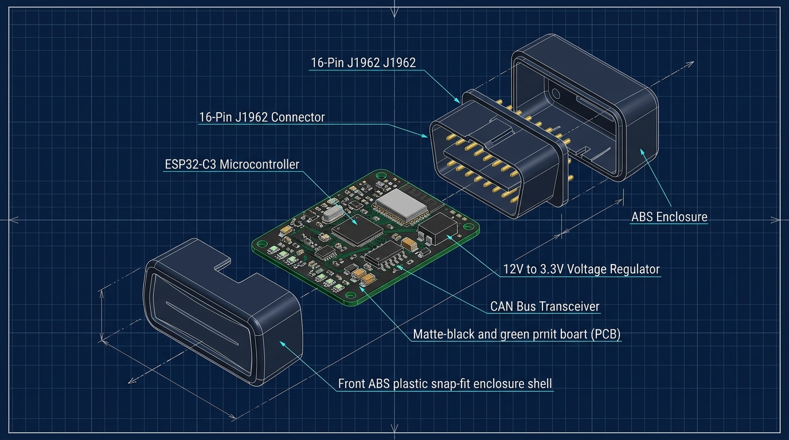

# 🔌 04. Nuestro Propio Kit Económico: Hardware, Planos y Fabricación

Para que **Tu-Auto** sea un negocio rentable y escalable, no podemos depender de que el usuario compre cualquier conector en internet (muchos compran clones defectuosos que no leen bien la computadora o solo andan en Android viejo). **Tener nuestro propio "Kit Económico Tu-Auto"** nos da margen de ganancia inmediato en la venta física y garantiza que la app se conecte en 3 segundos sin fallar.

En este documento se detallan los **2 caminos de hardware** (uno para salir a vender en 15 días con inversión mínima y otro para ensamblar/fabricar nuestro propio circuito inteligente), junto con los **planos técnicos, pinout, esquemáticos y costos**.


---

## 1. Estrategia en 2 Etapas para el Kit Económico

| Característica | **Etapa 1: Kit OEM Personalizado (Mes 1 a 6)** | **Etapa 2: Hardware Propio "Tu-Auto V1" (Mes 6+)** |
| :--- | :--- | :--- |
| **En qué consiste** | Comprar módulos OBD2 Bluetooth 4.0 BLE de grado industrial en fábrica, ponerles nuestra carcasa/sticker de resina y caja con código QR de activación. | Diseñar y ensamblar nuestra propia placa (PCB) basada en el microcontrolador **ESP32-C3** con sensor de arranque dedicado y alerta sonora integrada. |
| **Costo por unidad** | **\$3.50 a \$5.50 USD** (por mayor) / **\$8 a \$10 USD** (lotes chicos locales). | **\$4.20 a \$6.00 USD** fabricando PCB ensamblada (PCBA en JLCPCB/PCBWay). |
| **Precio de venta sugerido** | **\$25.000 a \$35.000 ARS** (~\$25 - \$30 USD). | **\$35.000 a \$45.000 ARS** (~\$35 - \$40 USD). |
| **Ventaja clave** | Salida inmediata al mercado sin gastos de matricería ni homologación electrónica. | Lee el voltaje de la batería con el auto apagado, tiene **buzzer (alarma sonora propia)** si recalienta el agua aunque el conductor no tenga el celular encima, y soporta Wi-Fi/BLE 5.0. |

---

## 2. El Secreto de la Etapa 1: Qué comprar para no fallar (Especificación OEM)

> [!CAUTION]
> **La trampa de los ELM327 baratos ("Versión 2.1 Azul"):** En MercadoLibre y AliExpress está lleno de conectores azules translúcidos que dicen "ELM327 v2.1" y cuestan \$3 USD. **NO SIRVEN**: usan chips recortados que no leen el protocolo ISO o CAN de muchos autos sudamericanos (VW Gol, Fiat Cronos, Corsa, Renault, Peugeot) y usan Bluetooth 2.0 (incompatible con iPhone).

### Especificación Exacta para pedir al proveedor (Ficha de Compra):
1. **Conectividad:** **Bluetooth 4.0 / 5.0 BLE (Bluetooth Low Energy) Dual-Mode**. Esto es obligatorio para que funcione tanto en **Android** como en **iOS (iPhone)** sin pedir códigos PIN raros de emparejamiento.
2. **Chip Controlador Interno:** **Microchip PIC18F25K80** (Firmware v1.5 real) con cristal oscilador de `4.000 MHz`. Este chip lee el **99% de los autos** fabricados desde 1998 hasta hoy (incluyendo protocolos lentos K-Line y CAN Bus de alta velocidad).
3. **Consumo en reposo (Sleep Mode):** Menor a `3 mA` para que el usuario pueda dejarlo enchufado todo el año sin que le descargue la batería del auto.
4. **Personalización Económica (Packaging "Tu-Auto"):**
   * Carcasa negra mate con sticker resinado ("Doming" 3D) con el logo **Tu-Auto**.
   * Caja pequeña de cartulina sulfatada impresa (costo: \$0.35 USD por caja).
   * En la tapa interna de la caja va impreso un **Código QR Único de Vinculación**: el usuario lo escanea desde la app y su auto queda enlazado automáticamente.

---

## 3. Planos e Ingeniería de Nuestro Propio Dispositivo ("Tu-Auto Smart Dongle V1")

Si queremos fabricar nuestro propio hardware (o mandarlo a ensamblar listo a fábricas rápidas como **JLCPCB** subiendo los planos), diseñamos una arquitectura superior al ELM327 tradicional usando un **ESP32-C3**.



### ¿Por qué nuestro diseño con ESP32-C3 supera a cualquier escáner común?
1. **Alarma Sonora Propia (Buzzer Piezoeléctrico en la placa):** Si el conductor se olvidó el teléfono en su casa o se quedó sin batería en el celular, el aparatito sigue leyendo la temperatura del agua del motor. Si pasa de **103°C**, el aparatito empieza a **chillar fuerte debajo del volante** salvando el motor.
2. **Memoria Interna (Caja Negra):** Guarda los últimos 30 días de voltajes de arranque y recalentamientos en su propia memoria Flash, y cuando el celular se acerca, le descarga todo el resumen en 2 segundos.
3. **Medidor Analógico de Batería de Alta Precisión:** Mide la caída de voltaje durante el arranque a **1.000 muestras por segundo (1 kHz)**, algo que un ELM327 común no puede hacer tan rápido.

---

### A. Plano del Conector del Auto: Pinout OBD2 (Estándar SAE J1962 - 16 Pines)

Mirando el enchufe del auto de frente (forma trapezoidal), estos son los pines que utiliza nuestro dispositivo:

```text
      _____________________________________________________
     /   1     2     3     4     5     6     7     8       \
    /                                                       \
   /     9    10    11    12    13    14    15    16         \
  /___________________________________________________________\
```

| Pin | Nombre Técnico | Función en **Tu-Auto** |
| :---: | :--- | :--- |
| **Pin 16** | `+12V Batería (Directo)` | **Alimentación continua** y lectura directa de salud de batería / alternador (siempre tiene corriente aunque el auto esté sin contacto). |
| **Pin 4** | `Chassis GND` | Masa / Negativo del chasis del vehículo. |
| **Pin 5** | `Signal GND` | Masa lógica de referencia para comunicación de datos. |
| **Pin 6** | `CAN High (ISO 15765-4)` | Línea principal de datos de alta velocidad (500 kbps) de la computadora del auto (todos los autos modernos). |
| **Pin 14** | `CAN Low (ISO 15765-4)` | Línea complementaria de datos CAN Bus. |
| **Pin 7** | `K-Line (ISO 9141-2 / KWP)` | Línea de diagnóstico para autos del Mercosur modelos 2000 a 2012 (Gol Power, Clio, Corsa, Palio). |

---

### B. Esquemático Electrónico de Bloques (Circuito Interno PCB)

```mermaid
flowchart TD
    subgraph Conector_OBD2 ["Conector Macho OBD2 (J1962)"]
        P16["Pin 16: +12V Batería"]
        P4_5["Pines 4 y 5: GND (Masa)"]
        P6_14["Pines 6 y 14: CAN H / CAN L"]
        P7["Pin 7: K-Line (Autos 2000-2012)"]
    end

    subgraph Etapa_Potencia ["1. Protección y Fuente (12V a 3.3V)"]
        TVS["Diodo TVS 1.5KE18A\n(Protección picos de arranque)"]
        BUCK["Regulador Step-Down MP2315 / LM2596\n(Convierte 12V-24V a 3.3V estables)"]
        DIV["Divisor Resistivo 100kΩ / 22kΩ (1%)\n(Escala 0-18V a 0-3.2V para lectura ADC)"]
    end

    subgraph Transceptores ["2. Intérpretes del Auto"]
        CAN_IC["Transceptor CAN Bus\nSN65HVD230 (3.3V)"]
        KLINE_IC["Transceptor K-Line\nL9637D (ISO 9141)"]
    end

    subgraph Cerebro ["3. Microcontrolador & Alertas"]
        MCU["ESP32-C3-MINI-1\n(RISC-V 160MHz + Bluetooth 5.0 BLE + Memoria Flash)"]
        BUZZER["Buzzer Activo SMD 85dB\n(Alarma sonora de Agua / Batería)"]
        LED["LED RGB WS2812B\n(Semáforo visual: Verde/Amarillo/Rojo)"]
    end

    P16 --> TVS
    TVS --> BUCK
    TVS --> DIV
    BUCK -->|3.3V VCC| MCU
    BUCK -->|3.3V VCC| CAN_IC
    DIV -->|GPIO 0 - ADC1| MCU

    P6_14 <--> CAN_IC
    CAN_IC <-->|TWAI / CAN TX-RX (GPIO 4, 5)| MCU

    P7 <--> KLINE_IC
    KLINE_IC <-->|UART TX-RX (GPIO 6, 7)| MCU

    MCU -->|GPIO 8| BUZZER
    MCU -->|GPIO 9| LED
```

---

### C. Explicación del Circuito de Medición Eléctrica (El "Detector de Batería y Alternador")

Para medir el sistema eléctrico con exactitud quirúrgica sin quemar el microcontrolador (que trabaja a `3.3V`), el **Pin 16 (`+12V`)** pasa por un **Divisor de Tensión Resistivo** conectado al conversor analógico-digital (`ADC`) del ESP32-C3:

$$V_{\text{ADC}} = V_{\text{Batería}} \times \frac{R_2}{R_1 + R_2}$$

* Si usamos $R_1 = 100\text{ k}\Omega$ y $R_2 = 22\text{ k}\Omega$:
  * Cuando la batería está en reposo a **$12.6\text{ V}$** $\rightarrow$ al chip entran **$2.27\text{ V}$**.
  * Cuando el alternador carga a **$14.4\text{ V}$** $\rightarrow$ al chip entran **$2.59\text{ V}$**.
  * Si hay una sobretensión peligrosa de **$18.0\text{ V}$** $\rightarrow$ al chip entran **$3.24\text{ V}$** (dentro del límite seguro de $3.3\text{ V}$).
* **Detección del Giro de Arranque (Cranking):** El ESP32 muestrea ese pin cada `1 milisegundo`. Cuando detecta que el voltaje cae de golpe de `12.5V` a `9.8V` y luego sube a `14.1V`, guarda automáticamente la **Curva de Arranque** y calcula el estado de salud (**SOH - State of Health**) de la batería sin que el usuario tenga que tocar nada.

---

### D. Lista de Materiales (BOM - Bill of Materials) para Fabricar 1 Unidad

Si encargás las placas ensambladas (PCBA) en proveedores como **JLCPCB** o **LCSC**, este es el costo real por unidad (en lotes de 100 unidades):

| Componente | Modelo / Referencia | Función | Costo Unitario (USD) |
| :--- | :--- | :--- | :---: |
| **Microcontrolador BLE** | `ESP32-C3-MINI-1` (4MB Flash) | Cerebro, Bluetooth 5.0 BLE y Wi-Fi | \$1.45 |
| **Transceptor CAN Bus** | `SN65HVD230DR` (Texas Instruments) | Conecta el ESP32 con la red CAN del auto | \$0.48 |
| **Transceptor K-Line** | `L9637D` | Soporte para autos Mercosur 2000-2012 | \$0.55 |
| **Regulador de Voltaje** | `MP2315` + Inductor + Diodo TVS `SMBJ18A` | Baja los 12V del auto a 3.3V con protección | \$0.42 |
| **Alarma y Estado** | Buzzer SMD `MLT-8530` + LED RGB + Pasivos | Alarma sonora de temperatura y luz testigo | \$0.30 |
| **Placa PCB + Ensamblaje** | PCB 2 capas (45mm x 25mm) + Soldadura SMT | Placa física lista y soldada por robot | \$0.75 |
| **Carcasa + Conector** | Carcasa plástica OBD2 J1962 macho 16 pines | Plástico ABS inyectado a presión (Snap-fit) | \$0.85 |
| **Packaging** | Caja impresa + Sticker QR de vinculación | Presentación comercial | \$0.40 |
| **TOTAL COSTO FÁBRICA** | **Dispositivo Completo "Tu-Auto V1"** | | **\$5.20 USD** |

---

## 4. Cómo Armar 1 Prototipo Casero esta misma semana (Con \$15 USD en tu mesa)

Si querés armar el **Hardware Propio** en tu escritorio comprando todo por MercadoLibre en el día para probarlo o mostrarlo:
1. Comprás una placa **ESP32-C3 SuperMini** (o ESP32 común) $\rightarrow$ ~\$6.000 ARS.
2. Comprás un módulo **Transceptor CAN MCP2551 o SN65HVD230** $\rightarrow$ ~\$3.500 ARS.
3. Comprás un **Regulador Step-Down LM2596** (12V a 3.3V/5V) y una **Ficha Macho OBD2 para armar** $\rightarrow$ ~\$6.500 ARS.
4. Soldás 6 cables siguiendo el plano de arriba, le cargamos el firmware en C++ / Arduino que programemos acá mismo, ¡y tenés tu propio hardware propietario funcionando!
