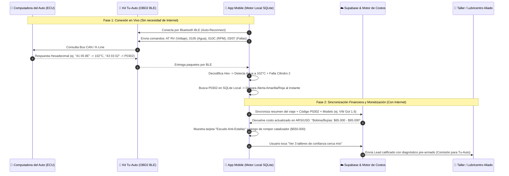

# 🛡️ 05. Auditoría Técnica de Desarrollo, Tecnologías, Plataformas y Features

Este documento constituye la **Auditoría de Ingeniería de Software y Producto** de **Tu-Auto**. Define con precisión qué tecnologías se utilizan, por qué se eligieron para minimizar costos y tiempos de desarrollo, qué plataformas sostienen el negocio y el catálogo completo de funcionalidades.

---

## 1. Stack Tecnológico Elegido (Arquitectura "Costo Cero al Inicio, Escalable a Millones")

Para que una sola persona (con asistencia de Agentes de IA) pueda construir, publicar y mantener todo el sistema sin pagar un equipo de 10 programadores, seleccionamos un stack **100% TypeScript** de punta a punta:

### 📱 A. Aplicación Mobile (iOS + Android + Web Demo)
* **Framework Principal:** **React Native con Expo (SDK 52+)** usando **Expo Router**.
  * *Por qué:* Con un solo código tenemos la app para Android, para iPhone y una versión Web interactiva para demos comerciales.
* **Lenguaje:** **TypeScript** (Tipado estricto para evitar errores al procesar tramas hexadecimales del auto).
* **Motor Bluetooth (Conexión al Auto):** **`react-native-ble-plx`** (para producción en dispositivos reales con Bluetooth Low Energy) combinado con un **`MockOBD2Provider` (Simulador Virtual)** para desarrollar y hacer demostraciones sin estar sentado adentro del auto.
* **Base de Datos Local en el Teléfono (Offline-First):** **`expo-sqlite`**.
  * *Por qué:* Si el auto va por la ruta sin señal de internet y recalienta el agua o tira una falla eléctrica, **la app NO puede depender de internet para avisarle al conductor**. Toda la tabla de fallas y umbrales críticos vive guardada adentro del celular y se sincroniza con la nube cuando vuelve la señal.
* **Estado y UI:** **Zustand** (manejo de estado en tiempo real a 10 lecturas por segundo sin trabar la pantalla) + **Lucide Icons** + Diseño **Dark Mode Automotriz** (alto contraste para ver rápido mientras se maneja).

### ☁️ B. Backend, Base de Datos y Motor Predictivo
* **Plataforma Backend-as-a-Service:** **Supabase (PostgreSQL + Auth + Edge Functions + Realtime)**.
  * *Por qué:* Nos da base de datos relacional robusta, login de usuarios (con Google/Email/Teléfono), funciones sin servidor (Deno/TypeScript) y seguridad por filas (Row Level Security) con una **capa gratuita enorme** (\$0 USD hasta miles de usuarios).
* **Motor de IA y Traducción de Costos:** **Supabase Edge Functions + Gemini API (Flash)**.
  * *Cómo se usa (con control de costos):* No llamamos a la IA en cada lectura. Los 500 códigos de falla más comunes ya están pre-traducidos y cotizados en nuestra base de datos. Solo cuando aparece una combinación rara de códigos en un modelo específico de auto, la Edge Function consulta a Gemini Flash (costo: centavos cada 1.000 consultas), genera el diagnóstico en criollo, y **lo guarda en caché en la base de datos** para que la próxima vez sea gratis.

---

## 2. Plataformas y Servicios Externos (Ecosistema Operativo)

| Área | Plataforma Elegida | Función en **Tu-Auto** | Costo Inicial (MVP) | Costo Escalado (1.000+ autos) |
| :--- | :--- | :--- | :---: | :---: |
| **Repositorio & CI/CD** | **GitHub + GitHub Actions** | Control de código y pruebas automáticas | **\$0 / mes** | \$0 / mes |
| **Compilación Mobile** | **Expo EAS (Application Services)** | Genera el archivo `.apk` / `.aab` (Android) y `.ipa` (iOS) en la nube sin necesitar una Mac | **\$0 / mes** (Plan Free: 30 builds/mes) | \$19 USD / mes (cuando escale) |
| **Base de Datos & API** | **Supabase** | Usuarios, autos, historial de telemetría, catálogo de precios y talleres | **\$0 / mes** (500 MB DB, 50.000 usuarios activos) | \$25 USD / mes (Plan Pro) |
| **Cobros y Suscripciones** | **MercadoPago (Suscripciones / Checkout Pro)** + **RevenueCat** | Cobro mensual con tarjeta de débito/crédito o dinero en cuenta en moneda local | **\$0 fijo** (Solo comisión por venta cobrada ~4-6%) | Comisión por transacción |
| **Notificaciones Push** | **Expo Push Notifications (FCM / APNs)** | Envía alertas al celular ("Te toca cambio de aceite esta semana", "El chofer desconectó el sensor") | **\$0 / mes** | \$0 / mes |
| **Monitoreo de Errores** | **Sentry** | Nos avisa si la app se cierra sola en algún modelo de celular específico | **\$0 / mes** (Plan Developer) | \$0 - \$26 USD / mes |
| **Analítica de Producto** | **PostHog** | Ver qué botones tocan más los usuarios y cuántos piden presupuesto a talleres | **\$0 / mes** (1 millón de eventos gratis/mes) | \$0 / mes |

---

## 3. Auditoría de Flujo de Datos: Del Motor del Auto al Bolsillo del Usuario

---

## 4. Catálogo Completo de Features (Módulos del Sistema)

### Módulo 1: Vigía del Sistema Eléctrico (`ElectricalGuard`)
* **Test Automático de Batería en cada Arranque:** Calcula el % de vida útil de la batería analizando cuánto cae el voltaje cuando gira el burro de arranque.
* **Diagnóstico en Vivo del Alternador y Regulador:** Verifica que con el motor encendido la tensión esté clavada entre `13.8V` y `14.4V`. Alerta inmediata si deja de cargar (correa cortada o carbones gastados) o si sobrecarga (riesgo de quemar la computadora o hervir la batería).
* **Detección de Fuga de Corriente:** Compara el voltaje cuando apagás el auto a la noche contra el voltaje a la mañana siguiente para avisarte si tenés alguna luz o alarma consumiendo batería en secreto.

### Módulo 2: Escudo Térmico y Control de "Agua" (`ThermalShield`)
* **Termómetro Digital Real (Anti-Aguja Mentinosa):** Muestra la temperatura real del sensor de tapa/refrigerante grado por grado.
* **Detector de "Falta de Agua / Manguera Rota" por Pendiente Térmica:** Algoritmo que mide cuántos grados por minuto sube el motor. Si detecta una subida brusca anormal (`+4°C cada 15 segundos` arriba de `96°C`), hace sonar una sirena en el teléfono aunque el auto todavía no haya prendido la luz roja.
* **Control de Electroventilador:** Verifica a qué temperatura exacta prende el electroventilador (ej. `98°C`) y a cuál apaga (`92°C`). Si pasa de `101°C` y la temperatura no baja, avisa: *"Falla en electroventilador o termostato trabado"*.

### Módulo 3: Algoritmo de Aceite y Mantenimiento Inteligente (`SmartMaintenance`)
* **Cálculo de Degradación de Aceite por "Kilómetros Equivalentes":**
  * 1 hora de motor encendido en embotellamiento (velocidad $< 15\text{ km/h}$) equivale a **45 km de desgaste de aceite**, aunque el odómetro del auto solo haya sumado 8 km.
  * El sistema suma kilómetros reales + horas de motor + cantidad de arranques en frío para mostrar el **% exacto de vida del aceite**.
* **Checklist Preventivo Automático:** Correa de distribución, filtro de aire/combustible, líquido de frenos y rotación de cubiertas con alertas a 30 y 7 días antes de vencer.

### Módulo 4: Traductor de Roturas y "Escudo Anti-Estafas" (`FaultTranslator`)
* **Lectura Dual (Modo 03 + Modo 07):** Lee tanto las fallas que ya prendieron el *Check Engine* como las **fallas silenciosas (Modo 07)** que recién empiezan a aparecer.
* **Tarjeta de Impacto en Billetera:**
  * *Gravedad:* Semáforo Verde / Amarillo / Rojo + ¿Puedo seguir manejando o llamo a la grúa?
  * *Qué pieza es y para qué sirve:* Explicado sin palabras difíciles.
  * *Precio Justo de Reparación:* Rango mínimo y máximo en moneda local (Repuesto + Mano de obra) para que el mecánico no te pueda cobrar el triple.
  * *Costo de Postergarlo:* Qué otra pieza más cara vas a romper si no lo arreglás a tiempo.

### Módulo 5: Predictor Financiero ("Tracking de Billetera") (`WalletPredictor`)
* **Presupuesto Mensual de Mantenimiento:** Le dice al usuario cuánto dinero separar por mes según el uso que le da al auto para que ningún arreglo o cambio de aceite sea una sorpresa.
* **Libreta Sanitaria Digital con Sello OBD2:** Historial inalterable de mantenimientos que aumenta el valor de reventa del vehículo.

### Módulo 6: Escáner de "Compra de Auto Usado" (`UsedCarInspector`)
* **Detector de "Borrado Reciente de Fallas":** Lee el PID `01 31` (Kilómetros recorridos desde que alguien borró los códigos de error con un escáner). Si vas a comprar un auto usado, te dicen *"el motor está impecable"* y la app te muestra: **"⚠️ ALERTA: Le borraron las fallas de la computadora hace solo 14 kilómetros"**, te salvaste de una estafa millonaria.

### Módulo 7: Panel para Dueños de Flotas / Uber / Remises (`FleetControl B2B`)
* Vista unificada para quien tiene de 2 a 20 autos trabajando con choferes.
* Alertas en el celular del dueño si un chofer lleva el motor recalentando, si se pasó del cambio de aceite, si maneja a altas RPM o si desconectó el dispositivo.
