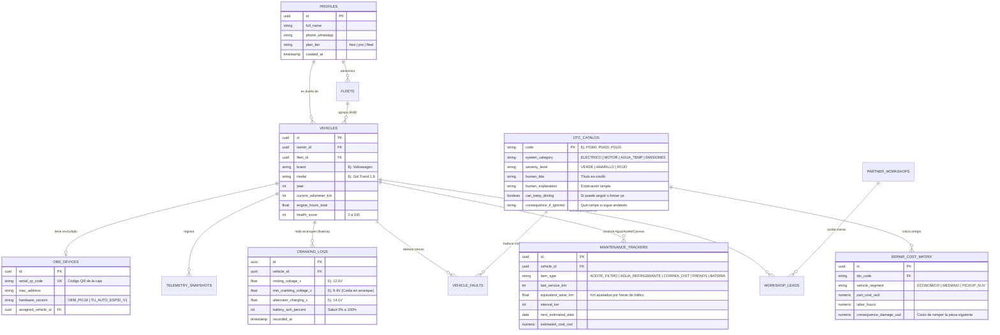

# 🗄️ 06. Arquitectura de Base de Datos y Esquema SQL Completo

Este documento define el modelo de datos de **Tu-Auto**, diseñado para soportar tanto **conductores particulares (B2C)** como **dueños de pequeñas flotas (B2B)**, el historial eléctrico/térmico del vehículo, el catálogo de precios de reparaciones en moneda local y la derivación de clientes a talleres aliados.

---

## 1. Diagrama Entidad-Relación (ERD)



---

## 2. Script SQL de Creación (Listo para correr en Supabase / PostgreSQL)

Este esquema utiliza **UUIDs**, índices optimizados para consultas rápidas desde la app móvil y **precios base dolarizados internamente** (que se multiplican automáticamente por el tipo de cambio del día para no quedar desactualizados por la inflación):

```sql
-- ============================================================================
-- TU-AUTO: ESQUEMA MAESTRO DE BASE DE DATOS (PostgreSQL / Supabase)
-- ============================================================================

-- 1. Perfiles de Usuario (Conductores y Dueños de Flotas)
CREATE TABLE public.profiles (
    id UUID PRIMARY KEY REFERENCES auth.users(id) ON DELETE CASCADE,
    full_name TEXT NOT NULL,
    phone_whatsapp TEXT,
    country_code TEXT DEFAULT 'AR',
    currency_code TEXT DEFAULT 'ARS',
    plan_tier TEXT DEFAULT 'free' CHECK (plan_tier IN ('free', 'pro', 'fleet_b2b')),
    subscription_status TEXT DEFAULT 'active',
    created_at TIMESTAMPTZ DEFAULT NOW()
);

-- 2. Flotas (Para clientes B2B: Dueños de autos en Uber/Cabify/Remiserías)
CREATE TABLE public.fleets (
    id UUID PRIMARY KEY DEFAULT gen_random_uuid(),
    owner_id UUID NOT NULL REFERENCES public.profiles(id) ON DELETE CASCADE,
    fleet_name TEXT NOT NULL,
    alert_whatsapp_number TEXT,
    created_at TIMESTAMPTZ DEFAULT NOW()
);

-- 3. Vehículos Registrados
CREATE TABLE public.vehicles (
    id UUID PRIMARY KEY DEFAULT gen_random_uuid(),
    owner_id UUID NOT NULL REFERENCES public.profiles(id) ON DELETE CASCADE,
    fleet_id UUID REFERENCES public.fleets(id) ON DELETE SET NULL,
    license_plate TEXT,
    brand TEXT NOT NULL,           -- Ej: 'Volkswagen', 'Fiat', 'Toyota'
    model TEXT NOT NULL,           -- Ej: 'Gol Trend', 'Cronos', 'Hilux'
    year INT NOT NULL,
    vehicle_segment TEXT DEFAULT 'ECONOMICO' CHECK (vehicle_segment IN ('ECONOMICO', 'MEDIANO', 'PICKUP_SUV', 'PREMIUM')),
    current_odometer_km INT NOT NULL DEFAULT 0,
    total_engine_hours NUMERIC(10,2) DEFAULT 0,
    normal_operating_temp_c INT DEFAULT 90,
    health_score INT DEFAULT 100 CHECK (health_score BETWEEN 0 AND 100),
    last_sync_at TIMESTAMPTZ,
    created_at TIMESTAMPTZ DEFAULT NOW()
);

-- 4. Inventario de Kits Hardware "Tu-Auto" (Vinculación por QR)
CREATE TABLE public.obd_devices (
    id UUID PRIMARY KEY DEFAULT gen_random_uuid(),
    serial_qr_code TEXT UNIQUE NOT NULL, -- Ej: 'TUAUTO-AR-000145'
    ble_mac_address TEXT,
    hardware_type TEXT DEFAULT 'OEM_BLE_4.0' CHECK (hardware_type IN ('OEM_BLE_4.0', 'ESP32_CUSTOM_V1')),
    assigned_vehicle_id UUID REFERENCES public.vehicles(id) ON DELETE SET NULL,
    activated_at TIMESTAMPTZ,
    is_active BOOLEAN DEFAULT TRUE
);

-- 5. Auditoría del Sistema Eléctrico (Batería y Alternador en cada Arranque)
CREATE TABLE public.electrical_cranking_logs (
    id UUID PRIMARY KEY DEFAULT gen_random_uuid(),
    vehicle_id UUID NOT NULL REFERENCES public.vehicles(id) ON DELETE CASCADE,
    resting_voltage_v NUMERIC(4,2) NOT NULL,      -- Voltaje antes de arrancar (normal: 12.4V - 12.7V)
    min_cranking_voltage_v NUMERIC(4,2) NOT NULL, -- Caída en el giro del burro (crítico: < 9.6V)
    alternator_voltage_v NUMERIC(4,2) NOT NULL,   -- Carga en marcha (normal: 13.8V - 14.4V)
    ambient_temp_c INT,
    battery_soh_percent INT NOT NULL,             -- Salud calculada de la batería (0 a 100%)
    alternator_status TEXT CHECK (alternator_status IN ('OK', 'BAJA_CARGA', 'SOBRECARGA_PELIGROSA')),
    recorded_at TIMESTAMPTZ DEFAULT NOW()
);

-- 6. Telemetría Térmica ("Agua") y Operativa (Resúmenes de Viaje y Alertas)
CREATE TABLE public.telemetry_snapshots (
    id UUID PRIMARY KEY DEFAULT gen_random_uuid(),
    vehicle_id UUID NOT NULL REFERENCES public.vehicles(id) ON DELETE CASCADE,
    max_coolant_temp_c INT NOT NULL,              -- Pico de temperatura de agua en el viaje
    temp_rise_rate_c_per_min NUMERIC(4,2),        -- Velocidad de calentamiento (detecta falta de agua)
    trip_distance_km NUMERIC(6,2) DEFAULT 0,
    trip_duration_minutes INT DEFAULT 0,
    idle_traffic_minutes INT DEFAULT 0,           -- Minutos detenido en tráfico (desgaste extra de aceite)
    overheating_event_triggered BOOLEAN DEFAULT FALSE,
    recorded_at TIMESTAMPTZ DEFAULT NOW()
);

-- 7. Catálogo Maestro de Códigos de Falla Traducidos (El "Cerebro" Mecánico)
CREATE TABLE public.dtc_master_catalog (
    code TEXT PRIMARY KEY,                        -- Ej: 'P0300', 'P0115', 'P0420', 'P0562'
    system_category TEXT NOT NULL CHECK (system_category IN ('ELECTRICO', 'AGUA_REFRIGERACION', 'MOTOR_INYECCION', 'ACEITE_LUBRICACION', 'EMISIONES_ESCAPE', 'TRANSMISION')),
    severity_level TEXT NOT NULL CHECK (severity_level IN ('VERDE', 'AMARILLO', 'ROJO')),
    human_title TEXT NOT NULL,                    -- Ej: 'Falla en el Sensor de Temperatura de Agua'
    human_explanation TEXT NOT NULL,              -- Explicación clara para alguien que no sabe de mecánica
    can_keep_driving BOOLEAN NOT NULL,
    driving_advice TEXT NOT NULL,                 -- Ej: 'Podés llegar a tu casa despacio, pero no salgas a la ruta'
    consequence_if_ignored TEXT NOT NULL          -- Ej: 'El electroventilador puede no prender y recalentar la tapa de cilindros'
);

-- 8. Matriz de Precios de Reparación y Riesgo Financiero ("Escudo Anti-Estafas")
-- Nota: Guardado en USD de referencia y convertido en vivo a ARS/moneda local según cotización actual
CREATE TABLE public.repair_cost_matrix (
    id UUID PRIMARY KEY DEFAULT gen_random_uuid(),
    dtc_code TEXT NOT NULL REFERENCES public.dtc_master_catalog(code) ON DELETE CASCADE,
    vehicle_segment TEXT NOT NULL CHECK (vehicle_segment IN ('ECONOMICO', 'MEDIANO', 'PICKUP_SUV', 'PREMIUM')),
    part_name TEXT NOT NULL,                      -- Ej: 'Bobina de encendido + Juego de Bujías'
    part_cost_min_usd NUMERIC(8,2) NOT NULL,
    part_cost_max_usd NUMERIC(8,2) NOT NULL,
    labor_cost_usd NUMERIC(8,2) NOT NULL,
    ignored_damage_cost_usd NUMERIC(8,2) NOT NULL,-- Cuánto sale la rotura grave si no lo arregla hoy
    updated_at TIMESTAMPTZ DEFAULT NOW(),
    UNIQUE(dtc_code, vehicle_segment)
);

-- 9. Fallas Detectadas en un Vehículo (Activas o Preventivas Modo 07)
CREATE TABLE public.vehicle_faults (
    id UUID PRIMARY KEY DEFAULT gen_random_uuid(),
    vehicle_id UUID NOT NULL REFERENCES public.vehicles(id) ON DELETE CASCADE,
    dtc_code TEXT NOT NULL REFERENCES public.dtc_master_catalog(code),
    obd_mode TEXT NOT NULL CHECK (obd_mode IN ('MODE_03_CONFIRMED', 'MODE_07_PENDING_PREDICTIVE')),
    odometer_at_detection_km INT,
    is_resolved BOOLEAN DEFAULT FALSE,
    detected_at TIMESTAMPTZ DEFAULT NOW(),
    resolved_at TIMESTAMPTZ
);

-- 10. Tracking Predictivo de Mantenimiento (Aceite, Agua, Distribución, Frenos)
CREATE TABLE public.maintenance_trackers (
    id UUID PRIMARY KEY DEFAULT gen_random_uuid(),
    vehicle_id UUID NOT NULL REFERENCES public.vehicles(id) ON DELETE CASCADE,
    item_type TEXT NOT NULL CHECK (item_type IN ('ACEITE_Y_FILTROS', 'LIQUIDO_REFRIGERANTE_AGUA', 'CORREA_DISTRIBUCION', 'BATERIA', 'PASTILLAS_FRENO')),
    last_change_date DATE NOT NULL,
    last_change_km INT NOT NULL,
    interval_km INT NOT NULL,                     -- Ej: 10.000 km para aceite, 60.000 km para distribución
    equivalent_wear_km NUMERIC(10,2) DEFAULT 0,   -- Kilómetros reales + penalización por horas de tráfico
    life_remaining_percent INT DEFAULT 100,
    estimated_next_date DATE,
    estimated_cost_usd NUMERIC(8,2) NOT NULL
);

-- 11. Red de Talleres y Lubricentros Aliados + Leads (Monetización por Comisión)
CREATE TABLE public.partner_workshops (
    id UUID PRIMARY KEY DEFAULT gen_random_uuid(),
    name TEXT NOT NULL,
    specialty TEXT NOT NULL CHECK (specialty IN ('LUBRICENTRO', 'ELECTRICIDAD_BATERIAS', 'MECANICA_GENERAL', 'INYECCION_ELECTRONICA')),
    address TEXT NOT NULL,
    city TEXT NOT NULL,
    whatsapp_phone TEXT NOT NULL,
    commission_percent NUMERIC(4,2) DEFAULT 10.00,
    is_verified BOOLEAN DEFAULT TRUE
);

CREATE TABLE public.workshop_leads (
    id UUID PRIMARY KEY DEFAULT gen_random_uuid(),
    vehicle_id UUID NOT NULL REFERENCES public.vehicles(id),
    workshop_id UUID NOT NULL REFERENCES public.partner_workshops(id),
    reason_summary TEXT NOT NULL,                 -- Ej: 'Cambio de Aceite Sintético 5W40 vencido (92% desgaste)'
    estimated_job_value_usd NUMERIC(8,2),
    commission_amount_usd NUMERIC(8,2),
    status TEXT DEFAULT 'SENT' CHECK (status IN ('SENT', 'CONTACTED', 'COMPLETED_PAID', 'CANCELLED')),
    created_at TIMESTAMPTZ DEFAULT NOW()
);
```

---

## 3. Base de Datos Local en el Celular (`SQLite Offline`)

Para que la app funcione en tiempo real sin consumir megas del celular en cada esquina:
1. Al abrir la app por primera vez, se descarga una copia liviana de `dtc_master_catalog` y `repair_cost_matrix` (pesa menos de `500 KB`) en el `SQLite` interno del teléfono.
2. Las lecturas de voltaje y temperatura de agua se evalúan **localmente en milisegundos**.
3. Solo se envía un resumen (`telemetry_snapshots`) a Supabase **al finalizar el viaje** o **en el instante en que se dispara una alerta amarilla/roja**.
