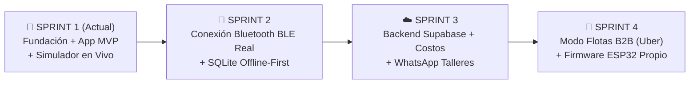

# 📋 09. Plataforma de Gestión de Proyecto (Alternativa Superadora a Taiga) y Roadmap por Sprints

Tenés toda la razón sobre **Taiga**: aunque fue popular hace años en el mundo open-source, hoy se quedó atrás (es lento, tiene una interfaz sobrecargada, cuesta configurarlo y **no tiene integración moderna con Agentes de IA**).

Para llevar un control milimétrico del desarrollo de **Tu-Auto**, investigamos las herramientas actuales de gestión ágil y definimos la combinación perfecta para trabajar **Humano + Agente de IA**.

---

## 1. Comparativa: ¿Qué usamos en lugar de Taiga?

Hoy existen **3 plataformas modernas** muy superiores a Taiga, todas con **Plan Gratuito completo** para nuestro equipo:

| Plataforma | Por qué supera a Taiga | Nivel de Integración con IA (Antigravity) | Veredicto para **Tu-Auto** |
| :--- | :--- | :--- | :--- |
| 🏆 **1. Linear (`linear.app`)** | Es el estándar de oro actual de todas las startups tecnológicas de Silicon Valley y Latam. Es **10 veces más rápido que Taiga**, tiene diseño oscuro impecable, Sprints automáticos ("Cycles"), Roadmaps visuales y app móvil excelente. | **Altísimo:** Se conecta directo a GitHub y tiene soporte MCP. Cuando subimos un cambio con el código de la tarea (ej. `TUA-005`), Linear mueve la tarjeta a *Done* automáticamente. | **La mejor opción visual externa (Gratis hasta 250 tickets activos).** |
| 🥈 **2. GitHub Projects V2** | Vive **adentro del mismo lugar donde guardamos el código** (`github.com`). Tiene tablero Kanban, tabla tipo Excel y línea de tiempo sin crear cuentas en otra página. | **Nativo Total:** Yo mismo (desde la terminal con el comando `gh`) puedo crear los tickets, etiquetarlos y mover las tarjetas de columna sin que vos tengas que tocar nada. | **Ideal para tener código y tablero en un solo lugar 100% gratis.** |
| 🥉 **3. Plane (`plane.so`)** | Es el sucesor moderno directo de Taiga y Jira (Open Source). Mucho más lindo y rápido que Taiga, con vistas de Ciclos y Módulos. | **Alto:** Muy buena API REST y webhooks. | Buena alternativa si algún día querés instalar tu propio servidor. |

---

## 2. Nuestra Solución "Doble Control": `BACKLOG.md` en Vivo + Linear / GitHub Projects

Para que **no pierdas ni 1 hora configurando servidores** y podamos ver el avance en tiempo real desde hoy mismo, implementamos el sistema **Git-Native Agile Tracking**:

1. **Tablero Maestro en el Repositorio ([`BACKLOG.md`](../BACKLOG.md)):**
   * Creé en la raíz de tu proyecto el archivo **[`BACKLOG.md`](../BACKLOG.md)** con las **32 tareas de ingeniería (`TUA-001` a `TUA-032`)** divididas en 4 Sprints.
   * Configuré una regla obligatoria en [`AGENTS.md`](../AGENTS.md) y una Skill dedicada ([`agile-backlog-manager`](../.agents/skills/agile-backlog-manager/SKILL.md)) para que **cada vez que yo (o cualquier subagente) programe una función, marque automáticamente la tarea como `[~] En Progreso` y luego `[x] Completada` con la fecha y el enlace al archivo creado**.
2. **Sincronización en 1 Clic con Linear o GitHub Projects:**
   * Como todas las tareas ya tienen formato estándar (`ID`, `Épica`, `Prioridad`, `Estimación`, `Criterio de Aceptación`), podés importarlas en 10 segundos a **Linear.app** (usando `linear.app` -> Import CSV/Markdown) o a **GitHub Projects** apenas subamos el repositorio a tu cuenta de GitHub.

---

## 3. Metodología de Trabajo por Sprints (Hoja de Ruta de 4 Semanas)

Dividimos todo el desarrollo de la plataforma en **4 Sprints cortos y enfocados en facturar**:

### 📅 SPRINT 1: Prototipo Funcional Completo + Simulador de Auto en Vivo (Semana 1)
* **Meta de Negocio:** Tener la aplicación funcionando en pantalla (Mobile + Web) con los relojes de Batería/Alternador, Agua/Temperatura, Aceite, el Traductor de Fallas con precios locales y el **Panel Simulador de 6 Escenarios** para salir a mostrar el producto a lubricentros y dueños de flotas.
* **Entregables Técnicos:** `TUA-001` a `TUA-014`.

### 📅 SPRINT 2: Conexión Bluetooth BLE Real (ELM327) + Motor Local SQLite (Semana 2)
* **Meta de Negocio:** Enchufar el primer conector físico al puerto OBD2 de un auto real, leer voltaje, RPM, temperatura de agua y códigos Modo 03/07 en vivo sin necesitar internet.
* **Entregables Técnicos:** `TUA-015` a `TUA-021`.

### 📅 SPRINT 3: Nube Supabase, Precios Dinámicos y Derivación a Talleres (Semana 3)
* **Meta de Negocio:** Conectar el login de usuarios, sincronizar la matriz de costos en pesos/dólares, habilitar el botón de derivación por WhatsApp a talleres aliados y pasarela de suscripción con MercadoPago.
* **Entregables Técnicos:** `TUA-022` a `TUA-027`.

### 📅 SPRINT 4: Panel de Flotas B2B (Uber/Remises) y Firmware Hardware Propio (Semana 4)
* **Meta de Negocio:** Habilitar la vista multi-vehículo para dueños de autos en alquiler y compilar el código C++ para nuestro propio dispositivo económico con `ESP32-C3` y alarma sonora integrada.
* **Entregables Técnicos:** `TUA-028` a `TUA-032`.
